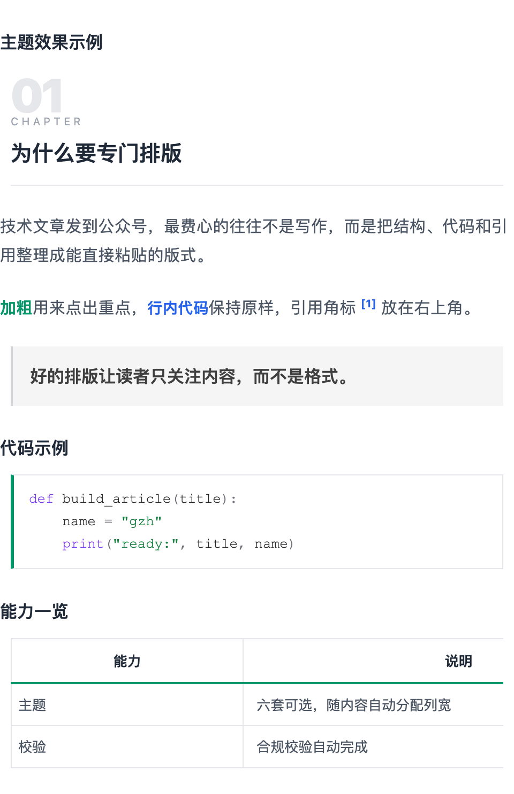
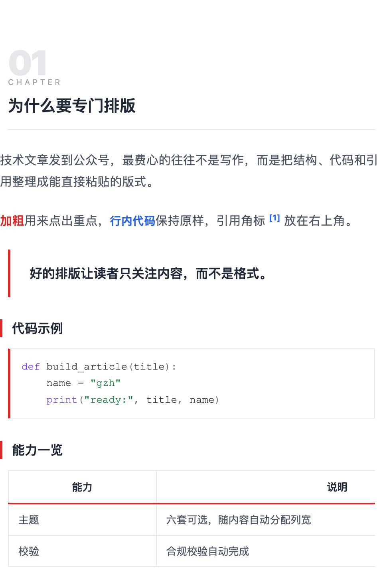
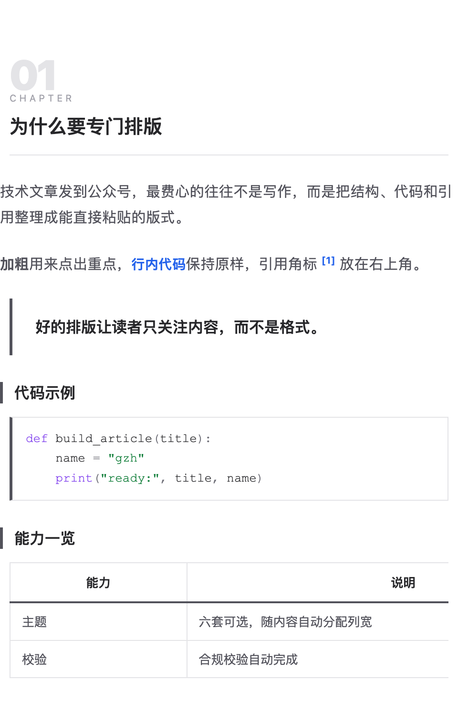
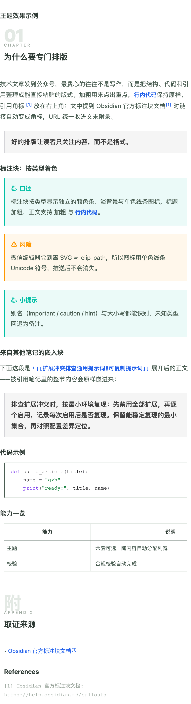
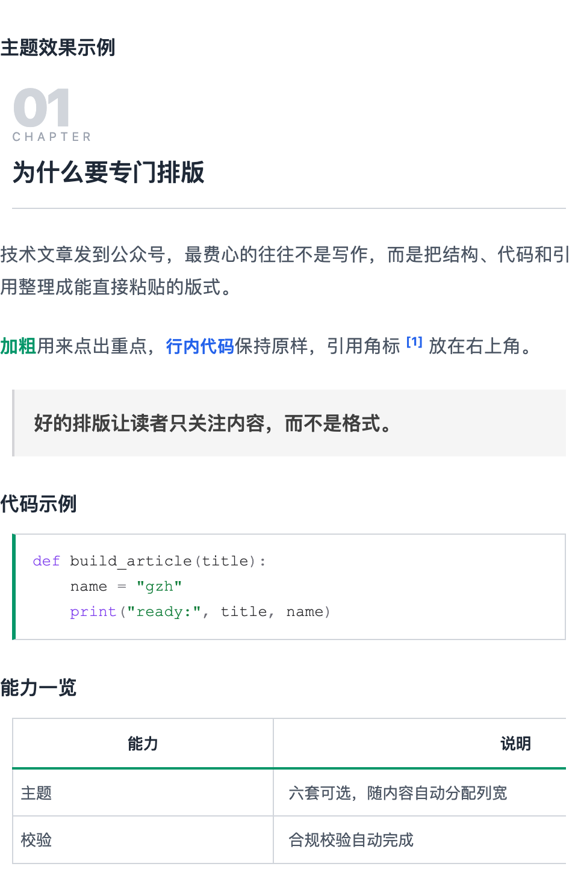
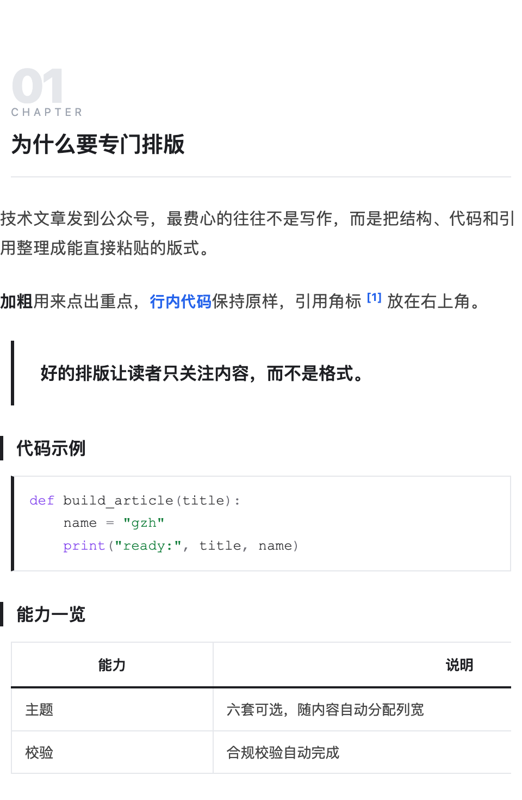

<div align="center">

# gzh-md-compose-push

**公众号 Markdown 排版 · 六套主题 · 扫码推送草稿 · 只存草稿不发布**

[](./SKILL.md)
[](./requirements.txt)
[](./LICENSE)

</div>

---

## 关于本项目

这个技能解决的是一件很具体的事：**把你写好的 Markdown，变成一篇能直接粘进公众号编辑器的文章，并安全地送进草稿箱**。

做它的原因，是当时手头的专家和技能各自只解决一部分问题：

| 已有的专家 / 技能                                                                      | 能做什么                                           | 缺什么                                                        |
| -------------------------------------------------------------------------------------- | -------------------------------------------------- | ------------------------------------------------------------- |
| gzh-layout-pro 公众号排版设计专家                                                      | 六套主题、主题预览、合规校验器                     | 只排版，不推送，还要人工复制粘贴                              |
| Wechat Publisher 技能                                                                  | 排版 + 代码高亮（主题与高亮分离）                  | 需要 AppID / AppSecret，个人未认证号用不了                    |
| wechat-draft-publisher 技能、wxmp-draft-publisher、gzh-content-ops、yanxu 言序等连接器 | 走官方接口创建草稿                                 | 全部依赖 AppID / 凭证；有的块类型有限，不能保留 HTML 代码高亮 |
| 公众号草稿箱推送技能（市场技能）                                                       | 个人微信扫码登录、浏览器驱动后台写草稿、覆盖与核验 | 排版能力弱，没有多主题与代码高亮                              |

把这些办法摆在一起，核心诉求就清楚了：

- **个人未认证公众号也能用**：不强制 AppID / AppSecret；
- **排版一次到位**：Markdown 直接得到可粘贴的公众号 HTML，多主题可选，代码高亮；
- **排版习惯要固定下来**：正文不放超链接，引用角标放右上角，实际超链接列在文末；表格按内容适配列宽，在手机上查看表格支持左右滑动；行内代码在渲染时无背景色，以适配深色主题；
- **过程要可控**：先给方案、再给成品、最后才推送；重复推送能选覆盖还是新建；
- **只写草稿，不代发布**：发布权始终在你手里；
- **存完要能验证**：回读草稿，确认标题、正文、图片和封面真的落进去了。

现成方案没有同时满足这几条的，所以本项目把几部分整合到了一起：排版专家的主题体系与校验思路，修正过代码块结构的 Markdown 转换器，再加上三段式确认，推送到草稿箱时支持覆盖 / 新建。**扫码/接口推送都内置在本技能里**。

## 核心能力

| 你想做的事                 | 本技能会怎么帮你                                                                                     |
| -------------------------- | ---------------------------------------------------------------------------------------------------- |
| 把 Markdown 变成公众号文章 | 自动处理标题、章节编号、引用、表格、行内代码、代码块，产出一份可以整段粘进公众号编辑器的 HTML        |
| 挑一个合适的版式           | 一次生成全部主题的预览页，你对照效果选一套；不选就不生成最终文件                                     |
| 让代码既能看清又不出错     | 关键字、字符串、数字等按颜色区分，且是可复制的文字；每行代码作为整体排版，不会被公众号拆行或撑大行距 |
| 保持你的排版习惯           | 引用角标放在右上角；正文链接改为纯文本来源清单；表格按内容宽窄适配                                   |
| 修改已经推过的文章         | 推送前先列出草稿箱里的标题，由你决定覆盖旧稿还是新建一篇                                             |
| 确认真的保存成功           | 保存后回读草稿，核对标题、正文长度、图片数量与封面，并给出通过 / 未通过结论                          |
| 微信扫码认证               | 用你自己的微信扫码登录公众号后台（默认）                                                             |
| AppID 与 AppSecret 认证    | 只有你明确要求走接口、并主动提供凭证时才启用                                                         |

### 六套主题，先看效果

下面是六套主题的真实渲染示意（同一篇示例文章，手机宽度）。**每套主题都有浅色 / 深色两种配色方案**，把主题名（和要浅色还是深色）告诉 Agent 即可选用，默认使用**石墨极简风·浅色**。下面的效果图会**跟随你查看页面的深浅模式自动切换**（GitHub 原生支持；不支持的平台会显示浅色图，深色观感见对应的 `*_dark.png`）。

| 主题                                                                                                                          | 适合的文章                                             |
| ----------------------------------------------------------------------------------------------------------------------------- | ------------------------------------------------------ |
| **摸鱼绿**（moyu-green）                                                                                                      | 教程、测评、清单、工具盘点                             |
| <picture><source media="(prefers-color-scheme: dark)" srcset="assets/themes/moyu-green_dark.png"></picture> | 绿色主色，明快、亲和                                   |
| **红白色系**（red-white）                                                                                                     | 深度分析、观点、有力量感的话题                         |
| <picture><source media="(prefers-color-scheme: dark)" srcset="assets/themes/red-white_dark.png"></picture> | 红色主色，醒目、有冲击力                               |
| **石墨极简风**（graphite-minimal）                                                                                            | 设计、科技评论、专业观点、高端品牌，也是本技能默认主题 |
| <picture><source media="(prefers-color-scheme: dark)" srcset="assets/themes/graphite-minimal_dark.png"></picture> | 灰黑主色，克制、留白多                                 |
| **留白禅意风**（zen-whitespace）                                                                                              | 禅意、极简生活、深度随笔、艺术留白                     |
| <picture><source media="(prefers-color-scheme: dark)" srcset="assets/themes/zen-whitespace_dark.png"></picture> | 墨绿主色，疏朗、安静                                   |
| **摸鱼票据风**（moyu-ticket）                                                                                                 | 测评、工具对比、创意评测                               |
| <picture><source media="(prefers-color-scheme: dark)" srcset="assets/themes/moyu-ticket_dark.png"></picture> | 绿色主色、票据式分隔线                                 |
| **橄榄手记**（olive-journal）                                                                                                 | 内刊手记、深度评测、案例复盘                           |
| <picture><source media="(prefers-color-scheme: dark)" srcset="assets/themes/olive-journal_dark.png"></picture> | 深色文字配橙色点缀，像笔记本                           |

挑主题时不必记住标识：直接说「用石墨极简风」或「换成留白禅意风，要深色」就行。想看自己文章在各主题下的样子，可以让 Agent 一次生成全部主题×配色的预览页再选。

> 效果图由 `scripts/gen_theme_images.py` 生成（示例文章源码在 `assets/themes/demo.md`）：浅色图为主题原样渲染，深色图按微信读者端 Dark Mode 转换算法（`wechatjs/mp-darkmode`）模拟。主题调整后运行该脚本即可重新生成 12 张图。

**浅色 / 深色两种配色方案**：浅色是白底深字（经典样式）。读者开深色模式时，**微信客户端会用官方转换算法自动把文章转成深色观感**（白底变深底、深字变浅字、品牌色相保留）——公众号的深浅自适配就是这条机制，作者只需按官方最佳实践写颜色；本技能的主题颜色全部 HEX 格式、对比度适中、无文字背景渐变，深色下自动可读。深色配色方案则是**写死的深色卡片**：无论读者系统怎么设都固定显示深底浅字，适合确定读者偏好深色的场景。预览页自带同样的深浅自适应：跟随浏览器/系统明暗自动切换深浅观感，也可点预览页工具栏的 🌗 按钮手动切换（自动/深/浅）。

## 快速开始

### 环境要求

| 你要做的事         | 需要准备什么                                                                                                                                 |
| ------------------ | ------------------------------------------------------------------------------------------------------------------------------------------ |
| 只排版、校验、预览 | Python 3，**不需要额外依赖**；Windows / macOS / Linux 都可以                                                                                |
| 扫码推送           | Python 3；Agent 具备浏览器操作能力（优先复用它自带的工具，按技能的精确契约调用接口）。没有该能力时，Agent 改用技能自带的 `mp_*.py` 脚本，自行安装几 MB 的浏览器驱动库并复用系统已装浏览器 |
| 官方接口推送       | Python 3；公众号的 AppID 与 AppSecret；后台配好本机公网出口 IP 白名单；账号需具备接口权限（个人未认证号通常没有）                           |
| 所有推送场景       | 一个公众号，以及能扫码登录它的个人微信                                                                                                       |

### 依赖由 Agent 负责

- **Python 3**：排版、校验、接口通道、扫码脚本都需要；纯排版只用标准库。
- **浏览器操作能力**：扫码登录、草稿写入、图片/封面上传、回读核验都靠它。优先复用 Agent 自带的浏览器工具（如 chrome-devtools MCP / CLI）：Agent 先探测宿主提供哪种工具，再把技能写死的 URL / 选择器 / JS / 判据翻译成该工具的接口调用。只有宿主没有可用工具时才走技能自带的脚本路径。
- **浏览器驱动库**：只有 Agent 需要运行技能自带的 `mp_*.py` 脚本时才装，由 Agent 自行安装；不需要你预装，也不需要额外下载浏览器内核。

两条扫码执行方式跑的是同一份操作契约，不是两套流程；差别只在谁来调用浏览器接口。详见 [浏览器工具复用契约](./references/browser-tool-contract.md)。

### 安装：让 Agent 自己装（推荐）

技能发布到 GitHub 后，把下面这段话发给你的 Agent（WorkBuddy、Claude Code、Codex、Cursor、Gemini CLI、OpenCode、DeepSeek Harness 等均可）。它会自己去拉仓库、装到正确位置并验证：

> 请帮我安装一个 Agent Skill。
>
> 名称：gzh-md-compose-push
> 来源：https://github.com/pollanyan/gzh-md-compose-push（也可以是我上传的 zip 文件或 SKILL.md 内容）
>
> 要求：
>
> 1. 先做安全审查：读一遍 `SKILL.md` 和 `scripts/` 里的脚本，说明它做什么、会不会动我的文件或隐私（尤其是公众号登录态目录 `scripts/mp_profile/`），值不值得装。
> 2. 优先用 skills CLI 安装：`npx -y skills@latest add https://github.com/pollanyan/gzh-md-compose-push --skill gzh-md-compose-push -a HOST -g -y`（`HOST` 换成你的宿主名，如 `claude-code` / `codex` / `cursor`）；如果本平台不在 skills CLI 支持列表（例如 WorkBuddy、DeepSeek Harness），就 `git clone` 仓库，把仓库根目录放到本平台的用户级 skills 目录，目录名必须是 `gzh-md-compose-push`（与 `SKILL.md` 里的 `name` 一致），保留 `SKILL.md` / `scripts` / `references` / `templates` / `assets` / `doc` 的完整结构，不要改技能内部文件。
> 3. 安装后验证：确认目录名与 frontmatter 一致；CLI 安装时再跑 `npx skills list -g`，列表里应出现 `gzh-md-compose-push`；最后读一遍 `SKILL.md`，说出它会怎么把一篇 Markdown 推到公众号草稿箱。
> 4. 告诉我安装路径、在本平台如何触发，以及纯排版 / 扫码 / 接口三条路径各自需要什么。

> `npx skills` 需要 Node.js 22.20+。Agent 会根据自己所在平台选择命令；普通用户不用先装 Python 依赖。

### 手动安装

#### 方式一：skills CLI 一行命令（推荐）

前置条件：Node.js 22.20+。仓库根目录本身就是技能（含 `SKILL.md`），CLI 能直接识别。

```bash
# 先看仓库里有哪些 skill
npx -y skills@latest add https://github.com/pollanyan/gzh-md-compose-push --list

# 安装到全局（所有项目可用），装给 Claude Code 与 OpenCode
npx -y skills@latest add https://github.com/pollanyan/gzh-md-compose-push --skill gzh-md-compose-push -a claude-code -a opencode -g -y

# 只想装给一个 Agent，把 -a 换成对应名字，例如 -a codex
# 复制文件而不是软链：加 --copy
```

其它常用：`npx skills list -g` 查看已装、`npx skills update gzh-md-compose-push` 更新、`npx skills remove gzh-md-compose-push` 卸载。完整参数见 [skills CLI](https://github.com/vercel-labs/skills)。

#### 方式二：CLI 不支持的平台（WorkBuddy / DeepSeek Harness）

`npx skills` 的 agent 列表目前没有 WorkBuddy 与 DeepSeek Harness，用 `git clone` 直接放到用户级 skills 目录：

```bash
# WorkBuddy：用户级，所有项目可用
git clone https://github.com/pollanyan/gzh-md-compose-push.git ~/.workbuddy/skills/gzh-md-compose-push

# 项目级：把目标目录换成 <项目目录>/.workbuddy/skills/gzh-md-compose-push
# DeepSeek Harness：换成 ~/.dsh/skills/gzh-md-compose-push
```

目录名必须保持 `gzh-md-compose-push`，与 `SKILL.md` frontmatter 的 `name` 一致；不要把仓库里的 `README.md`、`doc/` 等删掉。WorkBuddy 会自动发现该目录，不必重启。

### 验证安装是否成功

- 命令行安装：`npx skills list -g` 的输出里应出现 `gzh-md-compose-push`。
- 目录检查：用户级 skills 目录下存在 `gzh-md-compose-push/SKILL.md`，且其 frontmatter 的 `name` 为 `gzh-md-compose-push`。
- 行为检查：对 Agent 说「列出你已经安装的技能，确认 gzh-md-compose-push 在里面，并告诉我它会怎么把一篇 Markdown 推到公众号草稿箱」。如果它能说出「先排版确认、再扫码或接口推送、只存草稿」这个流程，说明技能已被正确加载。

### 先试一次：只排版，不推送

第一次使用建议先不碰公众号。你可以直接对 Agent 说：

> 先别推送。把这篇 Markdown 排成公众号 HTML，用石墨极简风，生成预览给我看。文章在 `<你的文件路径>`。

你会拿到两个文件：一份可直接粘贴的排版 HTML，和一份带「复制到公众号」按钮的预览页。排版过程会自动完成合规校验；全部通过时，你会看到明确的可粘贴结论。此时不会弹出二维码，也不会碰你的公众号。

## 从入门到实操：只用自然语言走通一次

不管走哪条通道，过程都是同一套**三段式确认**：

1. 先给你排版方案（主题和章节结构），你确认；
2. 再给你本地 HTML 和预览页，你确认满意；
3. 最后才推送草稿箱（重复推送先问覆盖还是新建），你确认。

每一步都会停下来等你，不会一口气跑完。

### 场景一：扫码推送（默认，个人公众号推荐）

#### 1. 说出你要做什么

> 把这篇 Markdown 排版成公众号文章，用石墨极简风，推到草稿箱。文件在 `<你的文件路径>`。

只要你说「推到草稿箱」而没有指定接口方式，就会走扫码通道；不会因为你没提供 AppID 而卡住，也不会擅自改用接口。

#### 2. 选主题

Agent 会先做出六套主题的预览页给你看，并说明各自适合什么文章。你可以对照上面「六套主题，先看效果」的图示直接选一套，也可以说「就用默认的」。这时还没有生成最终文件。

要不要封面、封面从哪来，Agent 确认排版方案时会主动问你（三个选项：自己提供 / AI 自动生成 / 不加），不用你先开口。

#### 3. 看排版结果，确认后再继续

Agent 会生成排版 HTML 和预览页，并**自动做公众号合规检查**——这一步不需要你自己调用任何工具。检查不通过它会先修，修好再给你看；通过时你会看到「完全合规、可直接粘贴」的结论。

不满意就说「换个主题」或「这段结构改一下」，此时不会推送。

#### 4. 决定覆盖旧稿还是新建

如果草稿箱里已有同标题文章，Agent 会先列出草稿标题让你看，然后问你「覆盖旧稿」还是「新建一篇」。选覆盖就会更新原来那篇，不会堆出一堆半成品；选新建则会另存一篇。

#### 5. 扫码登录

第一次使用或登录态过期时，Agent 会给你一张放大的微信二维码，用你的个人微信扫码即可。原始二维码只有 122 像素、很难扫，给你的是放大到约 490 像素的版本，扫完会自动删除。

登录态保存在技能自己的独立浏览器环境里，和你平时用的 Chrome 登录互不影响，下次一般不用再扫。等待扫码的最长时间是 900 秒；过期了 Agent 会重新给你二维码。

#### 6. 封面与署名（可选，封面三种来源）

确认排版方案时，Agent 会主动问两件事——封面怎么处理、署名用什么：

> **封面**：**① 自己提供**——直接贴图、给本地文件路径或网络 URL 都行；**② AI 自动生成**——按文章内容和配色生成一张封面（消耗少量生成额度，不满意可换构图重来）；**③ 不加**——草稿封面留空。
> **署名**：输入一次即记住，之后每次推送自动使用；不填则署名留空。

无论哪种封面来源，都会被统一处理成微信封面标准尺寸（900×383，2.35:1，中心裁剪——AI 生成图右下角的水印也会随裁剪去掉），你不用关心尺寸。给封面在**确认推送之前**都来得及：一开始说需求时带上，或等 Agent 主动问。给了封面，Agent 会先存草稿拿到草稿编号，再回到这篇草稿上设置封面——设置封面是推送动作内部的一步，不需要你再操作。正文插图在 Markdown 里即可：Agent 自动扫描 ``（本地路径、http/https 地址或 data URI），上传到公众号图片库并替换为微信图床地址。你不用手工改图片路径。

#### 7. 保存并核验

推送是最后一段确认：Agent 会主动问「确认推送到草稿箱吗」，你确认后它才会保存草稿。它只会点「保存」，**不会点发表、群发或发布**——点击前还会检查按钮文字，遇到这些字样直接拒绝，避免误触。

保存完成后，Agent 会回读这篇草稿，核对标题、正文长度、图片数量与封面，给出「通过」或「未通过」。只有通过后这次推送才算完成。最后它会告诉你草稿标题和编号，并提醒：**要发布请自己到公众号后台点。**

#### 这个场景下还能做什么

- **只排版不推送**：「把这篇 Markdown 排成公众号 HTML，用留白禅意风，先别推送。」
- **改稿后覆盖**：「这篇我改了几段，覆盖原来那篇草稿。」
- **换主题重来**：「回到主题预览，我想换一套。」
- **清除本机登录状态**：「帮我把这个技能保存的公众号登录状态清掉，也删掉临时二维码。」之后再用就需要重新扫码。
- **看草稿箱**：「列一下我公众号草稿箱里的文章标题。」

### 场景二：官方接口推送（你明确要求时才用）

#### 1. 提出要求并提供凭证

> 这次用官方接口推送。请告诉我怎么把 AppID 和 AppSecret 交给 Agent，不要把凭证写进脚本或放进文章里。

Agent 会引导你把凭证放到临时环境变量中，不写进技能文件、不落到文章内容里。通道选择权一直在你手里：你不说「用接口」，就永远走扫码通道。

#### 2. 先做权限和连通性检查

Agent 会先检查凭证与权限，再继续排版。常见结果：

- 提示 **40164**：说明本机公网出口 IP 没在白名单里。到公众号后台「设置与开发 / 开发设置 / IP 白名单」把当前出口 IP 加进去再试。微信是按 TCP 源 IP 校验的，改客户端配置或请求头都绕不过去。
- 提示 **48001**：说明账号没有接口权限，个人未认证号常见这种情况。这不是配置错误，改用上面的扫码通道，或先完成公众号认证。

#### 3. 排版与确认完全一样

主题预览、本地 HTML、预览页、合规校验、三段式确认，都和扫码场景一致；接口通道只替换最后「怎么把文章送进草稿箱」这一步。

#### 4. 创建草稿并核验

Agent 通过公众号官方接口创建草稿，只调用创建草稿相关的接口，**不会调用任何发布接口**。完成后会告诉你草稿的媒体编号，并提醒你到公众号后台草稿箱手动发布。

#### 这个场景下还能做什么

- 「列出接口通道创建的草稿。」
- 「删掉刚才那篇草稿。」
- 「我换了网络 / 换了凭证，清掉缓存重新来。」

## 工作原理

### 扫码通道

```text
你的 Markdown
      │  插图自动上传微信图床并替换地址
      │  转换成公众号可粘贴的 HTML（主题 + 代码高亮 + 合规校验）
      ▼
本地 HTML 和预览页 ──── 你确认后才继续
      │
      ▼
独立浏览器环境 ── 微信扫码登录公众号后台
      │  真实点击聚焦 + 剪贴板粘贴 HTML + 处理「继续插入」
      ▼
公众号草稿箱 ── 只保存，不点发表
      │
      ▼
回读草稿：标题 / 正文 / 图片 / 封面 → 通过或未通过
```

为什么一定要浏览器：二维码本身是微信服务器返回的，脚本只是把它截图放大；真正需要浏览器的是公众号后台这个网页应用——写标题、把带样式的正文粘进编辑器、上传图片和封面、读草稿列表、核对保存结果，都必须像真人一样操作页面。正文编辑器只认「真实点击聚焦 + 剪贴板写入带格式的 HTML + 粘贴」这条路径，直接改页面内容或模拟粘贴事件都会被丢弃。这一步优先由 Agent 调用自身浏览器工具按 [复用契约](./references/browser-tool-contract.md) 完成：契约把每一步的 URL、选择器、JS 和判据写死，Agent 只负责翻译成具体工具调用，不是自由发挥。没有可用浏览器工具时才由 `mp_*.py` 脚本执行同一份契约，那时才需要 patchright 作驱动库。

### 官方接口通道

```text
你的 Markdown ── 同一套排版 ──► 可粘贴 HTML
                                  │
你提供的 AppID / AppSecret（临时环境变量）
                                  │
                                  ▼
公众号官方接口：上传封面 / 图片 ── 创建草稿
                                  │
                                  ▼
公众号草稿箱 ── 不调用发布接口 ──► 你到后台手动发布
```

接口通道省掉浏览器，但换来的是凭证、IP 白名单和账号权限要求；个人未认证号通常被拒，所以它只是备选，不是默认。

## 配置说明

多数情况下你不需要配置任何东西。下面这几项只在特殊需求时才会用到。

### 扫码通道

| 项目         | 默认情况                                                                  | 什么时候需要在意                                                    |
| ------------ | ------------------------------------------------------------------------- | ------------------------------------------------------------------- |
| 浏览器       | 自动寻找系统里的 Chrome / Edge / Chromium，找不到再找浏览器驱动自带的版本 | 都没有时才需要让 Agent 帮忙下载一个浏览器内核；不需要手工指定路径   |
| 等扫码时间   | 900 秒，扫成功立即继续                                                    | 扫得慢也不用改；过期会重新给二维码                                  |
| 本机登录状态 | 技能目录下的独立浏览器环境，自动生成                                      | 含公众号后台完整登录凭证，**不要外传**；分享技能前让 Agent 帮你清除 |
| 临时二维码   | 登录后自动删除                                                            | 不要手工保存二维码图片                                              |

这一条通道不需要 AppID / AppSecret，也不涉及 IP 白名单。

### 官方接口通道

| 项目      | 怎么准备                                                           | 说明                                    |
| --------- | ------------------------------------------------------------------ | --------------------------------------- |
| AppID     | 公众号后台「设置与开发 / 基本配置」查看                            | 临时提供，不写进脚本或文章              |
| AppSecret | 同上，首次可重置后妥善保存                                         | 临时提供，不落盘                        |
| IP 白名单 | 公众号后台「设置与开发 / 开发设置 / IP 白名单」添加本机公网出口 IP | 微信按 TCP 源 IP 校验；换网络后要重新加 |

## 常见问题

### 通道与流程

<details>
<summary><b>一定要有 AppID 和 AppSecret 吗？</b></summary>

不一定要。默认扫码通道只需要你的微信扫码登录公众号后台，不需要任何接口凭证，个人未认证号也能用。只有你明确提出「用接口推送」时才需要 AppID / AppSecret 和 IP 白名单。

</details>

<details>
<summary><b>个人未认证公众号能用吗？</b></summary>

能用，走默认的扫码通道即可。官方接口通道对未认证账号通常会返回 48001（无接口权限），这时改用扫码通道，或先完成公众号认证。

</details>

<details>
<summary><b>为什么不默认用官方接口，不是更快吗？</b></summary>

因为个人未认证号走接口会被拒，还要凭证和白名单；公众号后台的私有操作还有签名与风控，硬模拟既脆弱又容易失效。扫码通道虽然第一次要扫一下，但后续会复用登录态，整体更稳。

</details>

<details>
<summary><b>一定要下载浏览器内核吗？</b></summary>

大多数情况下不用。脚本会自动找系统里已装的 Chrome / Edge / Chromium；只有这台机器一个都没有时，才需要让 Agent 帮忙下载。

</details>

<details>
<summary><b>patchright 是不是必须安装？</b></summary>

不是。纯排版和接口通道不需要；扫码通道优先复用 Agent 自带的浏览器工具，按技能的精确契约调用接口即可。只有宿主没有可用浏览器工具、Agent 改用技能自带的 `mp_*.py` 脚本时才需要这个驱动库，由 Agent 自行安装（几 MB，不额外下载浏览器内核）。

</details>

<details>
<summary><b>自然语言驱动能精确操作公众号后台吗？</b></summary>

能，但靠的不是「让 Agent 自由发挥」。技能把公众号后台的每一步写成精确契约：入口 URL、DOM 选择器、剪贴板写入的 JS、成功判据、禁止点击的按钮都写死；Agent 只把这些步骤翻译成当前浏览器工具的具体接口调用。自然语言只用来收集你的选择（主题、封面路径、覆盖还是新建），不用来决定怎么操作页面。

</details>

<details>
<summary><b>Agent 会自动适配不同的浏览器工具吗？</b></summary>

会。推送开始时 Agent 先探测当前宿主提供了哪些浏览器工具（MCP、技能或命令行都算），再按**接口能力**判断能否满足操作契约：能打开页面、能执行页面 JS、能发真实按键、能上传文件、有独立的持久化登录环境。全部满足就用它执行；缺关键能力（比如不能执行 JS 写剪贴板）就自动退回技能自带的 `mp_*.py` 脚本。适配看的是能力，不限定具体工具名字。

</details>

<details>
<summary><b>读者开了深色模式，文章会跟着变深吗？</b></summary>

会。微信客户端内置官方开源的 Dark Mode 转换算法（`wechatjs/mp-darkmode`），在读者端逐元素检测颜色：白底转深底、深色文字转浅色、对比度不足自动调整、高饱和品牌色保留色相。所以浅色排版的文章在深色模式下自动适配——这也是所有公众号文章深浅自适配的来源。本技能的主题颜色全部按官方最佳实践编写（HEX 格式、适度对比度、避免文字背景渐变、背景写在容器上），深色下可读性有保障。预览页内置同一算法的自适应模拟：跟随系统明暗自动切换，或点工具栏 🌗 按钮手动切换（自动/深/浅）；`--scheme dark` 则是写死的深色卡片，两种模式下都固定深底浅字。

</details>

<details>
<summary><b>不给封面路径会怎样？</b></summary>

草稿封面就是空的，保存不受影响。之后可以在公众号后台单独补封面，或让 Agent 用 `mp_cover_set.py` 给这篇草稿设置。给了封面时，Agent 会先存草稿拿到编号，再重开这篇草稿设封面——保存前设封面会静默失败。

</details>

<details>
<summary><b>署名怎么配置？会记住吗？</b></summary>

会。署名是配置项 **`author`**，由 `scripts/push_config.py` 管理，持久化在 **`~/.config/gzh-md-compose-push/config.json`**（环境变量 `GZH_PUSH_CONFIG` 可改存储位置），**默认值是空字符串（署名留空）**。流程：确认排版方案时的那轮提问里，Agent 会读当前配置并让你输入/修改，提交后立即写盘；下次推送自动使用，也可在那轮提问里改。不想署名就跳过，草稿作者栏为空（后台可补）。回读核验以配置值为预期：配置了署名则草稿署名须一致，配置为空则署名留空即通过。

</details>

<details>
<summary><b>合规校验要我自己调用吗？</b></summary>

不用。这是 Agent 在排版阶段的内部步骤：它会自动检查 HTML 是否满足公众号编辑器的结构要求，ERROR 和 WARNING 都清零才把成品交给你；不通过它会先修正。你要做的只是看预览、确认满意。

</details>

<details>
<summary><b>为什么要确认三次，不能一次做完吗？</b></summary>

因为排版口味和发布动作都不该由 Agent 替你决定。先定方案、再看成品、最后才推送，可以避免用错主题、把半成品推上去，或者误覆盖旧稿。

</details>

<details>
<summary><b>会不会一不小心把文章发出去？</b></summary>

不会。技能的边界就是只写草稿箱，绝不点发表、群发或发布；在点击按钮前还会检查按钮文字，遇到这些字样直接拒绝。最终发布必须由你到公众号后台亲自完成。

</details>

### 故障排查

<details>
<summary><b>粘贴后代码缩进错乱、行距被撑大</b></summary>

这是公众号把每个小片段当作不可拆的单位重新排版造成的。本技能已经改成「每行代码作为一个整体」，行内颜色用不带这种标记的普通文字实现。如果你自己改过转换逻辑，请恢复这种按行处理的方式，也不要退回图片方案。

</details>

<details>
<summary><b>粘贴后正文是空的，或者内容被丢掉</b></summary>

公众号编辑器会对粘贴的 HTML 做结构检查，可能弹出「内容结构检测」提示，需要点「继续插入」；不点的话内容会被静默丢弃。扫码脚本会自动处理这个提示。另外，文字背景不要用渐变，行高不要小于字号（例如 19px 字号配 1.45 以上行高）。如果仍是空的，让 Agent 清空编辑器后重新粘贴一次。

</details>

<details>
<summary><b>好像保存没成功</b></summary>

判断是否保存成功有两个依据：页面出现「保存成功 / 已保存」之类的短提示，或者地址栏链接里出现草稿编号。两者都没有就让 Agent 重试一次。公众号编辑器也会自动存草稿，调试时可能留下空白草稿，可以让 Agent 按标题清掉这些残留。

</details>

<details>
<summary><b>反复要扫码，或者登录状态失效</b></summary>

脚本又给出二维码，就说明登录态过期了；二维码约 4 分钟刷新一次，要扫的是那张放大版。如果浏览器环境被占用（残留进程锁），让 Agent 关掉残留进程或清除登录状态后重新扫码。入口必须是公众号后台首页；直接打开没有登录参数的子页面会被判为「请重新登录」，容易被误认成 Cookie 失效。

</details>

<details>
<summary><b>封面设置失败</b></summary>

公众号后台的封面按钮要先悬停才出现，页面上还有多个同名按钮，直接点往往点不中。可靠的做法是：先把文章存成草稿拿到草稿编号，再重新打开这篇草稿设置封面；保存前设封面会静默失败。另外，选图时要点图片库里的图片条目本身，等它显示文件名与预期一致再选——刚上传的图片微信需要转码，最多等 90 秒，等不到就放弃，不要随便选第一张。

</details>

<details>
<summary><b>正文图片不显示，或者数量不对</b></summary>

Markdown 中的插图由 Agent 自动上传并替换为微信图床地址，不用手工改。统计图片数量时要排除编辑器自动生成的分隔图片，否则一张图会被数成两张。上传脚本会给每张图加唯一文件名前缀，避免图片库同名冲突。

</details>

<details>
<summary><b>草稿打不开</b></summary>

通常有三种情况：提示「系统错误(320003)」表示这篇草稿不存在；提示「此草稿已被删除」表示编号已失效；提示「此草稿已发表」表示它已经移出草稿箱。都不是选择器坏了，按提示重新建一篇即可。如果列表页弹出切换账号相关的对话框，不要点里面的退出登录。

</details>

<details>
<summary><b>想覆盖旧草稿，但怕留下半成品</b></summary>

推送前让 Agent 列出草稿箱标题，选「覆盖」并告诉它目标标题，它会更新对应草稿而不是新建。删除草稿时 Agent 会重新核对标题，只删你确认过的那一篇。

</details>

<details>
<summary><b>接口通道报 40164</b></summary>

本机公网出口 IP 不在公众号白名单里。到公众号后台「设置与开发 / 开发设置 / IP 白名单」添加当前出口 IP 再试；微信按 TCP 源 IP 校验，改客户端配置或请求头都无效。换网络后需要重新添加。

</details>

<details>
<summary><b>接口通道报 48001</b></summary>

账号没有对应接口权限，个人未认证号常见。这不是配置错误，改用默认扫码通道即可；如果坚持用接口，先完成公众号认证。

</details>

<details>
<summary><b>排版校验不通过</b></summary>

不需要你自己处理。Agent 会在交付前把问题修掉；如果它反复修不好，把校验输出发给它，让它按提示调整文章结构后再重新生成预览。校验未通过时不要手动复制去粘贴。

</details>

## 目录结构说明

```text
gzh-md-compose-push/
├── SKILL.md                        # Agent 读取的技能入口：流程、边界、踩坑修正
├── README.md                       # 本文件
├── LICENSE                         # MIT 许可
├── requirements.txt                # 可选依赖：浏览器驱动库，仅扫码脚本路径需要
├── doc/
│   └── 方案设计规格.md              # 设计规格：需求结论、参考技能取证、生态盘点、验证记录
├── scripts/
│   ├── md_to_gzh.py                # Markdown → 公众号 HTML：主题、代码高亮、版式约定
│   ├── validate_gzh_html.py        # 公众号结构合规校验
│   ├── wrap_preview.py             # 生成带复制按钮的预览页
│   ├── mp_full.py                  # 扫码通道：登录、建草稿、覆盖、正文注入
│   ├── mp_check.py                 # 草稿回读核验
│   ├── mp_drafts.py                # 草稿列表与删除
│   ├── upload_md_images.py         # 扫描 Markdown 插图，上传微信图床并替换地址
│   ├── mp_imglib_upload.py         # 正文图片上传到微信图床
│   ├── mp_cover_set.py             # 单独设置或更换封面
│   ├── cover_prepare.py            # 封面归一化：本地路径/URL/AI 生成图 → 900×383
│   ├── push_config.py              # 用户配置项（author 署名等）：get/set/path
│   └── wx_api_publish.py           # 接口通道：检查、创建草稿、列表、删除
├── templates/
│   └── article_template.py         # 扫码通道的文章信息模板
├── assets/
│   ├── preview-template.html       # 预览页外壳
│   └── themes/                     # 本 README 中六套主题的效果示意图
└── references/
    ├── user-conventions.md         # 排版特殊约定（技能内部必读）
    ├── browser-tool-contract.md    # 扫码通道：复用 Agent 自带浏览器工具的操作契约
    ├── mp-wechat-notes.md          # 公众号编辑器踩坑清单（技能内部参考）
    └── ecosystem-survey.md         # 生态盘点与方案对比（技能内部参考）
```

## 文档

想了解「为什么这么设计、参考了哪些技能、验证过什么」，可以看 [方案设计规格](./doc/方案设计规格.md)。其余说明文件都是技能的组成部分，已经按上面的目录结构随技能一起安装，日常使用不必单独打开。

## 安全

- 扫码登录状态包含了公众号后台的完整登录凭证，**绝不外传**。
- 二维码是活码，扫码登录后会自动删除，不要手工留存。
- Agent 只保存草稿，不点发表、群发或发布；按钮文字会被检查，遇到这些字样直接拒绝。
- 合规校验在交付前自动完成，必须零错误、零警告；未通过时不会把成品交给你去粘贴。

## 致谢

本技能整合了若干已有专家与技能的思路和实现，在此致谢：

- **gzh-layout-pro 公众号排版设计专家** —— 六套主题体系与合规校验思路；
- **公众号草稿箱推送技能（森智道）** —— 扫码登录、本机登录态持久化、剪贴板注入、覆盖草稿与回读核验的浏览器底座；
- **Wechat Publisher 技能** —— 主题与代码高亮分离的参数设计，以及封面必填的实测经验；
- **patchright / Playwright 生态** —— 稳定驱动公众号后台的浏览器自动化能力；
- **微信公众号官方接口** —— 可选接口通道的草稿创建能力。

## 许可

MIT License。完整条款见 [LICENSE](./LICENSE)。
